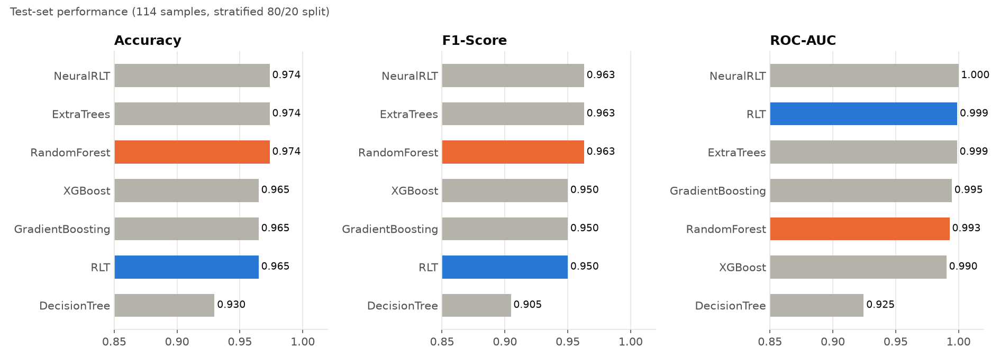
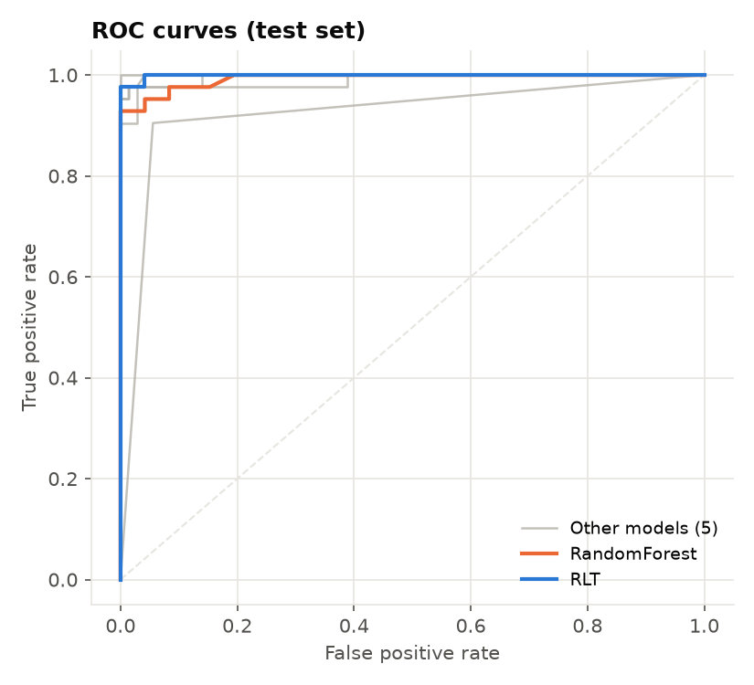
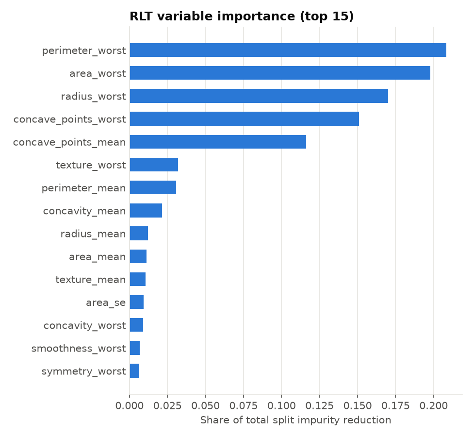
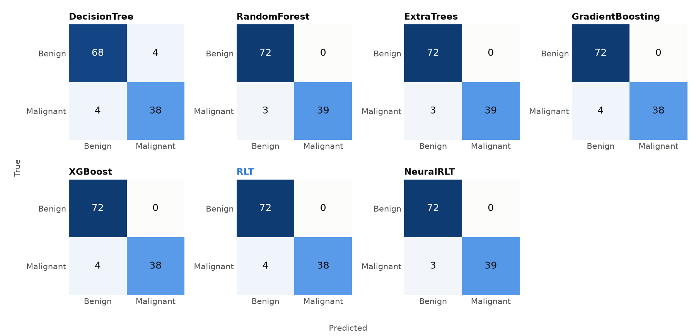

<div align="center">

# 🌳 Reinforcement Learning Trees for Breast Cancer Classification

**A from-scratch reproduction of _Reinforcement Learning Trees_ (Zhu, Zeng & Kosorok, JASA 2015),<br/>benchmarked against 5 tree ensembles and our own Neural RLT, and served through a FastAPI REST API.**

🎓 **Class project (paper reproduction)** by Ayoub Rebhi, Mahmoud Ben Khelil, Medali Mraihi, Molka Boukhris, Semah Ayachi and Yassine Maazaoui

[](https://www.python.org/)
[](https://scikit-learn.org/)
[](https://xgboost.ai/)
[](https://www.tensorflow.org/)
[](https://fastapi.tiangolo.com/)
[](tests/)
[](LICENSE)

[The paper](#-the-paper-reinforcement-learning-trees) •
[Results](#-results) •
[Neural RLT](#-our-addition-neural-rlt-not-part-of-the-paper) •
[Notebooks](#-notebooks) •
[API](#-api) •
[Quick start](#-quick-start) •
[Citation](#-citation)

</div>

---

## 📄 The paper: Reinforcement Learning Trees

> Zhu, R., Zeng, D. & Kosorok, M. R. (2015). *Reinforcement Learning Trees.* Journal of the American Statistical Association, 110(512), 1770–1784. [doi:10.1080/01621459.2015.1036994](https://doi.org/10.1080/01621459.2015.1036994)

Classic CART / random-forest splits are **greedy**: at each node they pick the variable with the best *immediate* impurity reduction, often among a random subset of variables. In high-dimensional, sparse problems (many noise variables, few strong ones) this wastes splits on noise, and deeper nodes, which contain few observations, can no longer tell signal from noise.

RLT borrows the reinforcement-learning idea of choosing the action with the best **long-term reward**: a split variable should be chosen for its effect on the *whole subtree* below the node, not just the next cut. Three mechanisms implement this:

| Mechanism | What happens at each internal node | Why |
|---|---|---|
| 🔭 **Embedded model** | An Extremely Randomized Trees model is fitted on the node's data and gives a variable importance (VI) for every candidate variable. The node splits on the variable with the largest VI. | VI from a whole model measures the "future" value of a variable, including interactions, instead of a marginal one-step gain. |
| 🔇 **Variable muting** | The variables with the lowest VI (a fraction *p<sub>d</sub>*) are **muted**: they are never considered again in the node's descendants. Variables already used to split along the path are **protected** and never muted. | Noise variables are progressively removed, so small, deep nodes still focus on the strong variables. |
| ➗ **Linear combination splits** | Optionally, the top *k* variables (with VI ≥ α·max VI) are combined as *z = Σ sign(ρ<sub>j</sub>) √VI<sub>j</sub> · x<sub>j</sub>* and the node splits on *z*. | Oblique splits capture structures that are hard to approximate with axis-aligned cuts. |

The paper proves consistency and shows that the convergence rate depends on the number of **strong** variables instead of the total dimension *p*. Empirically, RLT's largest gains are in high-dimensional, sparse settings.

## 🔬 What we reproduced

| | |
|---|---|
| **RLT forest** ([`models/rlt.py`](models/rlt.py)) | Implemented from scratch as a scikit-learn compatible `RLTClassifier` (`fit` / `predict` / `predict_proba`, works with `clone`, `cross_validate`, …). Each node fits an embedded Extra-Trees model and computes **out-of-bag permutation VI**, splits on the best variable or on a **linear combination** of the top-*k*, **mutes** the weakest unprotected variables and keeps a **protected set**. Trees are grown on bootstrap samples in parallel and their leaf class distributions are averaged. |
| **Step-by-step RLT** ([notebook 01](notebook/01_rlt_breast_cancer.ipynb)) | Root node VI, muting and split computed by hand, then a single-tree `RLTClassifier`, an 8-model comparison and hyperparameter search. |
| **Other datasets of the paper** ([notebooks 02, 03](#-notebooks)) | The same method applied to the **Sonar** and **Ozone** UCI datasets. |
| **Benchmark** ([`main.py`](main.py)) | RLT vs Decision Tree, Random Forest, Extra Trees, Gradient Boosting, XGBoost and our **Neural RLT** ([our addition](#-our-addition-neural-rlt-not-part-of-the-paper), not from the paper), all on the **same stratified split**. |
| **Deployment** ([`api/`](api/)) | FastAPI service serving the RLT forest, Neural RLT and the 5 baselines, with model comparison and PDF report export. |

<details>
<summary><b>Implementation details and hyperparameters</b></summary>

<br/>

| Parameter | Value | Paper notation |
|---|---|---|
| `n_estimators` | 100 trees | *M* |
| `muting_rate` | 0.5 ("moderate") | *p<sub>d</sub>* |
| `combination_size` | 2 variables per split | *k* |
| `alpha` | 0.25 | α |
| `embedded_n_estimators` | 25 extremely randomized trees per node | — |
| `min_samples_split` / `min_samples_leaf` | 10 / 3 | *n<sub>min</sub>* |

* **Variable importance**: increase of the out-of-bag Brier score when a variable is permuted, averaged over the embedded trees. If no variable has a positive permutation VI (tiny nodes), the impurity importance of the same embedded model is used.
* **Cut point**: exhaustive search of the Gini-optimal threshold on the chosen variable (or on the linear combination *z*).
* **Muting floor**: muting never reduces the active set below `min_features = 3` variables.
* **Tuning**: `muting_rate ∈ {0, 0.5, 0.8}` × `combination_size ∈ {1, 2, 3}` were compared by **5-fold CV on the training set only**. All configurations with muting ≤ 0.5 scored within one standard deviation of each other (CV accuracy 96.0–96.7%, std ≈ 1.5–2%). `muting=0.5, k=2` (96.5% CV accuracy, 0.991 CV ROC-AUC) is 0.2 points below the top configuration, and we kept it so that the paper's muting stays active. Aggressive muting (0.8) was consistently worse (≈ 94.7%).
* **Speed**: the embedded model uses low-level tree prediction for the permutation loop, and trees are grown in parallel with `joblib`. 100 trees train in ≈ 10–25 s on a 16-core laptop, against ≈ 40 s **per tree** for the first version of the code.

</details>

## 📊 Dataset

**Wisconsin Diagnostic Breast Cancer** ([UCI #17](https://archive.ics.uci.edu/dataset/17/breast+cancer+wisconsin+diagnostic)): 569 patients, 30 real-valued features computed from digitised images of fine-needle aspirates (mean, standard error and worst value of radius, texture, perimeter, area, smoothness, compactness, concavity, concave points, symmetry and fractal dimension). Target: **Malignant (212) vs Benign (357)**. The file is included at [`data/wdbc.data`](data/wdbc.data).

**Protocol (every model, every script):** stratified train/test split, `test_size=0.2`, `random_state=42` (455 train / 114 test, of which 42 malignant). Features are standardised with a scaler fitted on the training set. Positive class = Malignant.

## 🏆 Results

Test-set metrics (114 held-out patients), produced by `python main.py` ([`docs/benchmark_results.csv`](docs/benchmark_results.csv)):

| Model | Accuracy | Precision | Recall | F1 | ROC-AUC | Train time |
|---|:---:|:---:|:---:|:---:|:---:|:---:|
| Random Forest | **0.9737** | **1.0000** | **0.9286** | **0.9630** | 0.9929 | 0.3 s |
| Extra Trees | **0.9737** | **1.0000** | **0.9286** | **0.9630** | 0.9988 | 0.2 s |
| 🧪 Neural RLT *([our addition](#-our-addition-neural-rlt-not-part-of-the-paper), not in the paper)* | **0.9737** | **1.0000** | **0.9286** | **0.9630** | **1.0000** | 1–3 min |
| **🌳 RLT (paper method, this repo)** | 0.9649 | **1.0000** | 0.9048 | 0.9500 | 0.9990 | 22 s |
| Gradient Boosting | 0.9649 | **1.0000** | 0.9048 | 0.9500 | 0.9947 | 0.7 s |
| XGBoost | 0.9649 | **1.0000** | 0.9048 | 0.9500 | 0.9904 | 0.5 s |
| Decision Tree | 0.9298 | 0.9048 | 0.9048 | 0.9048 | 0.9246 | < 0.1 s |
| *RLT single tree (notebook 01)* | *0.9386* | *0.9487* | *0.8810* | *0.9136* | — | — |

<p align="center">
  
</p>

### Does RLT beat Random Forest here? No, and that is expected

On this split the RLT forest classifies **110/114** patients correctly against **111/114** for Random Forest. The gap is a **single malignant patient**: RLT misses the same 3 malignant cases as Random Forest plus one more, and all models except the Decision Tree have zero false positives. RLT has the **best ROC-AUC among the tree models (0.9990 vs 0.9929 for Random Forest)**, second only to our Neural RLT: its probabilities rank patients slightly better, but at the 0.5 threshold it is one patient behind. Why RLT does not win on this dataset:

1. **It is not the setting RLT was designed for.** RLT's advantage comes from muting noise variables when *p* is large and only a few variables matter. WDBC has only 30 features and most are informative: radius, perimeter and area, for example, are almost collinear and all carry the signal. With few noise variables to mute, RLT behaves like a well-tuned forest. This matches the CV results, where muting 0% vs 50% made no significant difference.
2. **The test set is small.** One patient is 0.88 points of accuracy. The CV standard deviation (≈ 1.5–2%) is larger than every difference between the top six models, which are statistically tied.
3. **It costs more.** An embedded model is fitted at every node, so training is ≈ 100× slower than Random Forest (seconds instead of milliseconds). That is fine for 569 samples, but it matters at scale.

The RLT forest is still a clear improvement over the single RLT tree from the notebook (93.9% → 96.5% accuracy). Its variable importance concentrates on the "worst" size features (perimeter, area, radius) and on concave points, which are also the features most correlated with the diagnosis in the EDA of notebook 01:

<details>
<summary><b>More figures: ROC curves, confusion matrices, RLT variable importance</b></summary>

<br/>
<p align="center">
  
  
</p>
<p align="center">
  
</p>

</details>

## 🧪 Our addition: Neural RLT (not part of the paper)

> [!IMPORTANT]
> **Neural RLT is our own idea, added on top of the reproduction. It does not appear in Zhu, Zeng & Kosorok (2015)** and should not be read as a result of the paper.

**The idea:** keep the *forest recipe* that RLT and random forests share (many randomized learners, each trained on a bootstrap sample and a random subset of variables, then averaged), but replace every tree with a small neural network. Every model in the comparison is tree-based, so the neural networks give a non-tree learner inside the same ensemble framework.

| | Neural RLT ([`models/neural_rlt.py`](models/neural_rlt.py)) |
|---|---|
| **Ensemble** | 10 members, each trained on a bootstrap sample of the training set; predicted probabilities are averaged |
| **Feature randomization** | Each member sees a random subset of √p = 5 of the 30 features |
| **Member network** | Dense 64 → 32 → 16 (ReLU, He init), batch normalization and dropout 0.3 after each layer, sigmoid output |
| **Training** | Adam (lr = 0.001), binary cross-entropy, up to 50 epochs, batch size 32 (Keras holds out 10% of each bootstrap sample as a validation split), early stopping and learning-rate reduction on the training loss |
| **Reproducibility** | Fixed seeds + TensorFlow op determinism: re-training gives **bit-identical** probabilities |
| **Where it is used** | Benchmark (`main.py`), the saved API models (`train_and_save.py`) and every API endpoint (`model_name=NeuralRLT`) |

**Results:** Neural RLT ties for the best accuracy (97.37%, 111/114) and reaches a ROC-AUC of 1.0000 on this test set. That is the same accuracy as Random Forest and Extra Trees (same 3 missed malignant cases) and one patient more than RLT.

**What it is *not*:** despite the name, Neural RLT keeps none of the three RLT mechanisms. It has no embedded model, no variable muting, no protected set and no splits. Technically it is a bagged, random-subspace ensemble of neural networks. It is also the most expensive model here: about 1–3 min of training and about 0.3 s per API prediction, against milliseconds for the tree ensembles. As with the other models, a tie on 114 test patients is not evidence that it is better in general.

## 📓 Notebooks

| Notebook | Dataset | Content | Result (as saved in the notebook) |
|---|---|---|---|
| [`01_rlt_breast_cancer.ipynb`](notebook/01_rlt_breast_cancer.ipynb) | WDBC (UCI 17) – 569 × 30 | EDA, RLT built step by step (root VI, muting, protected set, split), `RLTClassifier` single tree, comparison with 7 classifiers, grid & random search, Gradio demo | RLT single tree **93.86%** test accuracy (Random Forest 97.37%) |
| [`02_rlt_sonar.ipynb`](notebook/02_rlt_sonar.ipynb) | Sonar, mines vs rocks (UCI 151) – 208 × 60 | RLT forest with ExtraTrees VI and muting | **73.0%** test accuracy (tuned), 68.3% (default) |
| [`03_rlt_ozone.ipynb`](notebook/03_rlt_ozone.ipynb) | Ozone level detection (UCI 172) – 5070 × 72 | RLT forest with ExtraTrees VI and muting | 95.4% accuracy, **but see note** |

> [!NOTE]
> These notebooks are earlier, simplified prototypes written before the forest in `models/rlt.py`: they use impurity-based VI, simpler split rules and no linear combinations. On **Ozone**, only 4.6% of the days are ozone days, and the notebook's 95.4% accuracy is exactly the majority-class baseline: the model predicts "no ozone" for every day (recall 0 on the positive class). An honest evaluation on this dataset needs class weighting or threshold tuning and should report ROC-AUC / F1 instead of accuracy.

## 🌐 API

The FastAPI app ([`api/`](api/)) loads the 7 trained models (5 baselines, RLT and our Neural RLT) from [`trained_models/`](trained_models/) once at start-up and exposes REST endpoints to predict with one model, compare all models with a majority-vote consensus, and export a PDF report ([example](docs/sample_report.pdf)).

Start the server with `uvicorn api.app:app --reload` (after `pip install -r requirements.txt`); the interactive Swagger documentation is then at http://127.0.0.1:8000/docs.

| Method | Endpoint | Description |
|---|---|---|
| `GET` | `/api/health` | Service status and loaded models |
| `GET` | `/api/models` | List of available models |
| `POST` | `/api/predict?model_name=RLT` | Diagnosis, probabilities and risk level from one model (`DecisionTree`, `RandomForest`, `ExtraTrees`, `GradientBoosting`, `XGBoost`, `RLT`, `NeuralRLT`) |
| `POST` | `/api/compare` | Predictions of all models plus the majority-vote consensus |
| `POST` | `/api/export-pdf?patient_id=...&date=...` | PDF report with every model's prediction and the input measurements |
| `GET` | `/docs` | Interactive Swagger documentation |

<details>
<summary><b>Example request</b></summary>

```bash
curl -X POST "http://127.0.0.1:8000/api/predict?model_name=RLT" \
  -H "Content-Type: application/json" \
  -d '{"radius_mean": 17.99, "texture_mean": 10.38, "perimeter_mean": 122.8, "area_mean": 1001,
       "smoothness_mean": 0.1184, "compactness_mean": 0.2776, "concavity_mean": 0.3001,
       "concave_points_mean": 0.1471, "symmetry_mean": 0.2419, "fractal_dimension_mean": 0.07871,
       "radius_se": 1.095, "texture_se": 0.9053, "perimeter_se": 8.589, "area_se": 153.4,
       "smoothness_se": 0.006399, "compactness_se": 0.04904, "concavity_se": 0.05373,
       "concave_points_se": 0.01587, "symmetry_se": 0.03003, "fractal_dimension_se": 0.006193,
       "radius_worst": 25.38, "texture_worst": 17.33, "perimeter_worst": 184.6, "area_worst": 2019,
       "smoothness_worst": 0.1622, "compactness_worst": 0.6656, "concavity_worst": 0.7119,
       "concave_points_worst": 0.2654, "symmetry_worst": 0.4601, "fractal_dimension_worst": 0.1189}'
```

```json
{"model_name": "RLT", "diagnosis": "Malignant", "confidence": 95.42,
 "probabilities": {"Benign": 4.58, "Malignant": 95.42}, "risk_level": "High"}
```

</details>

> [!WARNING]
> Educational project. The models are trained on 455 patients from one dataset and must not be used for medical decisions.

## 🚀 Quick start

```bash
git clone https://github.com/yassinemaazaoui114-git/RLT-Project.git
cd RLT-Project

python -m venv .venv
.venv\Scripts\activate            # Windows
# source .venv/bin/activate       # macOS / Linux
pip install -r requirements.txt

python train_and_save.py          # train the 7 API models -> trained_models/ (+ metrics.json)
python main.py                    # full benchmark incl. Neural RLT -> docs/benchmark_results.csv + figures
python main.py --no-neural        # same, without the Neural RLT
uvicorn api.app:app --reload      # API on http://127.0.0.1:8000 (Swagger docs at /docs)
pytest                            # 24 tests: RLT unit tests + every endpoint with every model
```

Pre-trained models are committed in `trained_models/`, so the API runs right after `pip install`. Use the RLT directly:

```python
from models.rlt import RLTClassifier
from utils.data_loader import load_split

X_train, X_test, y_train, y_test, scaler = load_split()
rlt = RLTClassifier(n_estimators=100, muting_rate="moderate", combination_size=2, random_state=42)
rlt.fit(X_train, y_train)
print(rlt.score(X_test, y_test), rlt.predict_proba(X_test[:3]))
```

## 🗂️ Project structure

```
├── api/
│   ├── app.py                  # FastAPI app
│   ├── routes/prediction.py    # /predict, /compare, /export-pdf, /health, /models
│   ├── schemas.py              # Pydantic input/output schemas (30 features)
│   └── utils/pdf_generator.py  # ReportLab PDF report
├── models/
│   ├── rlt.py                  # ⭐ Reinforcement Learning Trees (RLTClassifier)
│   ├── neural_rlt.py           # 🧪 Neural RLT: our addition, not from the paper
│   └── baselines.py            # Baseline models + optional GridSearch tuning
├── utils/
│   ├── data_loader.py          # Dataset loading and the shared train/test split
│   ├── evaluation.py           # Accuracy, precision, recall, F1, ROC-AUC
│   └── visualizations.py       # Benchmark figures
├── notebook/                   # Research notebooks (breast cancer, sonar, ozone)
├── trained_models/             # Saved models, scaler, feature info, metrics.json
├── tests/                      # pytest: RLT unit tests + API end-to-end tests
├── data/wdbc.data              # Wisconsin Diagnostic Breast Cancer dataset
├── docs/                       # Figures, benchmark results, sample PDF report
├── main.py                     # Full benchmark pipeline
├── train_and_save.py           # Trains and saves the API models
└── config.py                   # Paths, feature names, split settings, tuning grids
```

## 📚 Citation

If you use this code, please cite the original paper:

```bibtex
@article{zhu2015reinforcement,
  title   = {Reinforcement Learning Trees},
  author  = {Zhu, Ruoqing and Zeng, Donglin and Kosorok, Michael R.},
  journal = {Journal of the American Statistical Association},
  volume  = {110},
  number  = {512},
  pages   = {1770--1784},
  year    = {2015},
  doi     = {10.1080/01621459.2015.1036994}
}
```

Dataset: W. Wolberg, O. Mangasarian, N. Street & W. Street, *Breast Cancer Wisconsin (Diagnostic)*, UCI Machine Learning Repository, 1995. [doi:10.24432/C5DW2B](https://doi.org/10.24432/C5DW2B)

## 📝 License

[MIT](LICENSE) © 2026 Yassine Maazaoui
